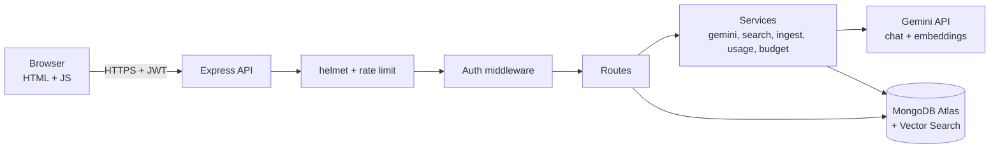
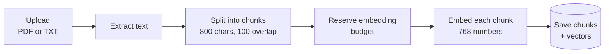
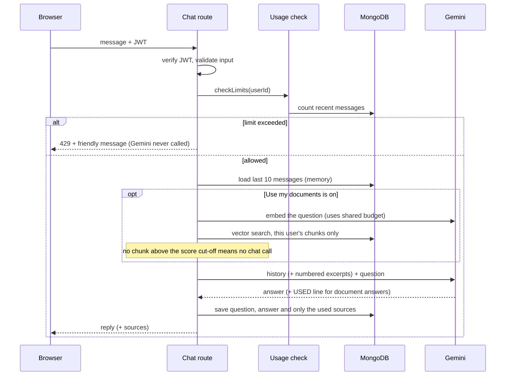
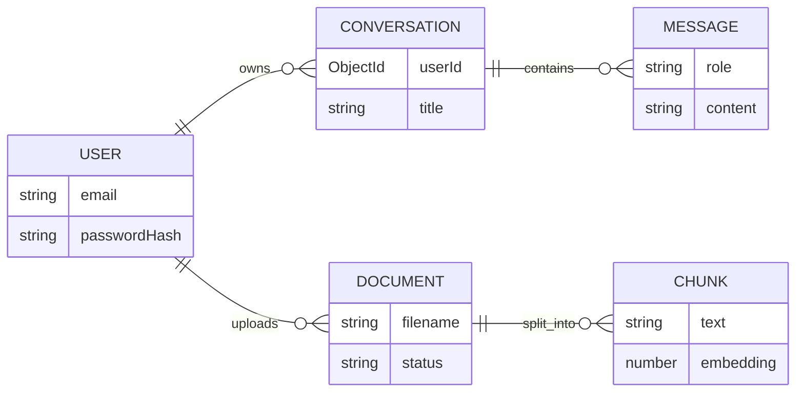

# DocuChat

> Chat with an AI, or chat with your own documents. Built on Node.js, Express and MongoDB, powered by Google Gemini. Upload a PDF or TXT, ask questions, and get answers grounded in the file, with the passages that were used shown as sources. Answers stream in, and a personal usage screen shows your activity.


[](https://github.com/Milind300/docuchat/actions/workflows/test.yml)

<!-- Add after recording:  -->
<!-- Live demo: https://YOUR-LINK -->

---

## Status

| Feature | State |
|---|---|
| Register / login (JWT, bcrypt), protected routes | Done |
| Gemini chat with conversation memory, saved chats, history sidebar | Done |
| Streaming answers (Server-Sent Events) with a typing effect | Done |
| Delete a chat | Done |
| Document upload (PDF, TXT), chunking, embeddings, vector search | Done |
| Answers from documents, showing only the sources the answer used | Done |
| Upload, list and delete documents in the UI | Done |
| Usage limits (per user per minute, per user per day, app-wide) | Done |
| Shared embedding quota cap (per minute and per day) | Done |
| Security headers, login and register rate limiting, input validation | Done |
| Startup checks for missing or weak settings | Done |
| Personal analytics: questions and tokens per day, document citations | Done |
| "My usage" screen with charts | Done |
| Light and dark UI following the system setting | Done |
| Streaming for document answers | Planned |
| Automated tests (162) and CI with GitHub Actions | Done |
| Deployment | Planned |

---

## Tech Stack

| Layer | Technology | Purpose |
|---|---|---|
| Runtime | Node.js 24 (ES modules) | Non-blocking I/O suits an app that mostly waits on the database and the LLM |
| Web framework | Express 5 | REST API; async errors reach the error handler automatically |
| Database | MongoDB Atlas (free tier) | Users, chats, documents, chunks, counters |
| ODM | Mongoose 9 | Schemas, validation, indexes |
| Vector search | Atlas Vector Search (`$vectorSearch`) | Similarity search in the same database, no separate vector store |
| Chat model | Google Gemini via `@google/genai` | Answers, streamed |
| Embeddings | `gemini-embedding-001`, 768 dimensions | Turns text into vectors |
| Streaming | Server-Sent Events over `fetch` | Answers arrive in pieces without WebSockets |
| Auth | JWT (`jsonwebtoken`) + `bcryptjs` | Stateless sessions, hashed passwords |
| Hardening | `helmet` | Security headers |
| File upload | `multer` (memory storage) | Files are processed in memory, never written to disk |
| PDF parsing | `unpdf` | Text extraction from PDFs |
| Config | `dotenv` | Secrets kept out of Git |
| Frontend | Vanilla HTML, CSS, JavaScript | Served by Express, no build step, no chart library |

---

## Architecture



**Layering:** Route (HTTP only) → Service (business rules, external calls) → Model (schema and persistence). All Gemini calls live in two small service files, so swapping the model or provider touches nothing else. No state is kept in server memory: limits and counters live in MongoDB, which suits serverless hosting.

---

## High-Level Design

### Ingestion: from file to searchable chunks



Refusals that happen before any work (no text, too large, budget used up) create no document. If a later step fails, partly saved chunks are removed and the document is marked `FAILED` with the reason.

### One chat request



### Streaming (plain chat)

Plain questions use `POST /api/chat/stream`, which replies with Server-Sent Events: `text` pieces, then `done` (or `error`). Document answers use the normal route, because they end with a line naming the sources used.

- **All checks run before the stream starts** (login, validation, limits, conversation ownership), so they return normal JSON errors with proper status codes. After the first byte the status can't change.
- **The question is saved before streaming**, so a user can't dodge the daily limit by cancelling streams.
- **If the AI fails before any text arrives,** the question is removed, since a failure shouldn't cost the user an allowance.
- **If the browser leaves midway,** the question stays and tiny fragments are not saved as answers.
- **Errors during the stream** are sent as an `error` event, because the status code is already sent.
- The browser reveals text at a steady pace (a typing effect). The pieces themselves arrive in bursts, so this is cosmetic.

Design points:

- **Gemini is called before anything is saved** (for non-streamed answers), so a failed AI call leaves no half-saved conversation.
- **Limits run before any AI call,** so blocked requests cost no quota.
- **Memory** is the last 10 messages sent with each request, because the model itself keeps no state.
- **Retrieval** keeps the top 4 chunks scoring at least 0.765. If none qualify, the app answers "nothing relevant found" without calling the chat model.
- **Grounding:** the prompt tells the model to answer only from the excerpts, to treat them as data and not instructions, and to say when the answer isn't there.
- **Sources:** the model is asked to end with a line naming the excerpts it used. The server strips that line and keeps only those sources; if the line can't be read, all retrieved sources are shown.

---

## Low-Level Design

### Data model



| Collection | Index | Why |
|---|---|---|
| `users` | unique `email` | One account per email |
| `conversations` | `{ userId, updatedAt: -1 }` | "My chats, newest first" without a collection scan |
| `messages` | `{ conversationId, createdAt }` | "This chat in order" without a collection scan |
| `messages` | `{ userId, createdAt: -1 }` | Usage limits and analytics filter by user and date |
| `documents` | `{ userId, createdAt: -1 }` | "My documents" and the daily upload count |
| `chunks` | `{ documentId, index }`, `{ userId }` | Read a document in order; scope by owner |
| `chunks` (Atlas vector index) | `embedding`: 768 dims, cosine, filter on `userId` | Similarity search limited to the owner's chunks |
| `embeddinglogs` | TTL on `createdAt` (3 days) | App-wide embedding usage per minute and per day |
| `ratelimits` | unique `bucket`, TTL on `expiresAt` | Login and register attempt counters |

Notes:

- Messages are a separate collection, so a long chat never inflates one document.
- An assistant message stores the `sources` it used (document, chunk, score, snippet), so reopened chats show their sources.
- Embeddings are excluded from queries by default (`select: false`); a validator rejects any vector that isn't exactly 768 numbers.
- Documents have a status: `PROCESSING`, `READY`, `FAILED`, `DELETED`. Deleting removes the chunks and the document's entries in old answers' sources, and keeps the record so the daily upload count stays honest.
- Deleting a chat removes the answers and the conversation, but keeps the question rows with their text replaced by `[deleted]`, so usage limits can't be reset by deleting chats.

### API

| Method | Route | Auth | Description |
|---|---|---|---|
| POST | `/api/auth/register` | No | Create account, returns JWT. Rate limited |
| POST | `/api/auth/login` | No | Returns JWT. Rate limited |
| GET | `/api/auth/me` | Yes | Current user |
| POST | `/api/chat` | Yes | Ask a question. Body: `message`, optional `conversationId`, optional `useDocuments` |
| POST | `/api/chat/stream` | Yes | Same for plain chat, streamed as Server-Sent Events |
| GET | `/api/conversations` | Yes | My conversations, newest first |
| GET | `/api/conversations/:id/messages` | Yes | One conversation's messages with sources |
| DELETE | `/api/conversations/:id` | Yes | Delete one of my chats |
| POST | `/api/documents` | Yes | Upload a PDF or TXT (multipart, field `file`) |
| GET | `/api/documents` | Yes | My documents |
| DELETE | `/api/documents/:id` | Yes | Delete one of my documents |
| GET | `/api/analytics/summary?days=14` | Yes | My questions and tokens per day (1 to 60 days), plus today against my limit |
| GET | `/api/analytics/documents` | Yes | How often each of my documents is cited |
| GET | `/api/health` | No | Health check |

### Limits

| Rule | Value |
|---|---|
| Chat messages per user per minute | 3 |
| Chat messages per user per day | 20 |
| Chat messages per day, whole app | 450 |
| Document uploads per user per day | 3 (deleted ones still count) |
| File size / type | 4 MB, PDF or TXT |
| Chunks per document | 60 maximum, roughly 7 pages of text |
| Embedding requests, whole app | 80 per minute, 900 per day |
| Login attempts per IP | 10 per 15 minutes |
| Register attempts per IP | 5 per hour |

The app shares one free-tier Gemini key, so limits protect its daily quota. Counts come from saved data, so no in-memory state is needed. The day boundary follows Pacific midnight, matching how Google's daily quota resets, and the analytics use the same day.

Measured on the free tier: each chunk counts as one embedding request, so one 60-chunk upload uses 60 of the 100 per minute Google allows. The app-wide cap sits below Google's limit and refuses new work with a clear message before it is exceeded.

### Analytics

The analytics endpoints return **only the caller's own data**. There is no cross-user ranking, because without admin roles it would expose other people's usage. Days with no activity are returned as zeros so charts have a continuous timeline.

Known gaps in the numbers: output tokens and citation counts drop when chats are deleted (their answers are removed); a cancelled stream records no tokens; and embedding usage is not included, since its log expires after three days.

### Project structure

```
docuchat/
├── .github/workflows/ CI: runs the tests on every push and pull request
├── public/            Frontend: index.html, style.css, app.js, format.js
├── scripts/           Dev utilities (checks run by hand against a live setup)
├── tests/             unit/, integration/ (Vitest + Supertest), helpers/
└── src/
    ├── app.js         Express app wiring, security headers
    ├── server.js      Boot: check settings, connect DB, then listen
    ├── config/        db, limits, rag, env, startupChecks
    ├── middleware/    auth (JWT guard), rateLimit
    ├── models/        User, Conversation, Message, Document, Chunk, EmbeddingLog, RateLimit
    ├── routes/        auth, chat, chatStream, conversations, documents, analytics
    ├── services/      gemini, usage, chunker, embeddings, embeddingBudget, ingest, search, extract, rateLimit
    └── utils/         pacificTime.js
```

---

## Security and Privacy

- **Passwords** are hashed with bcrypt (cost 12); the hash is excluded from queries by default.
- **Login errors** are the same for an unknown email and a wrong password.
- **Brute force:** login and register are rate limited per IP, using atomic counters in MongoDB.
- **Input validation:** credentials must be text, the email must be well formed (254 characters at most), the password at most 72 characters. Objects such as `{"$ne": null}` are rejected before any query. Malformed JSON returns 400, oversized bodies 413, and the JSON body is capped at 100 KB.
- **Headers:** `helmet` sets a strict Content Security Policy, `nosniff`, frame protection and a no-referrer policy, and removes `X-Powered-By`.
- **Tenant isolation:** every chat, document, chunk and analytics query filters by the authenticated `userId`. The vector search is pre-filtered by `userId`, so one user's documents can never appear in another's answers.
- **Uploads** are processed in memory and never written to disk. Only PDF and TXT are accepted, up to 4 MB.
- **Prompt and output handling:** document text is treated as data in the prompt, and model output is rendered by a small formatter that builds elements with `textContent`, never `innerHTML`. The same applies to the usage screen.
- **Secrets** live in `.env` (git-ignored). At startup the server refuses to run if `JWT_SECRET` is missing, too short or a placeholder, or if Gemini settings are missing. Messages name the setting, never its value.
- **Free-tier privacy:** Google may use free-tier prompts for product improvement. Do not upload sensitive documents. The upload panel shows this warning.

---

## Design

The interface follows the principles of clarity, deference and depth from Apple's Human Interface Guidelines. It is inspired by them, not an Apple product.

- System font stack, readable sizes, generous spacing and 44px tap targets.
- One accent color, a translucent blurred header, soft shadows and rounded shapes.
- Light and dark themes follow the system setting, using one set of color tokens.
- Visible keyboard focus, and animations switch off when the system asks for reduced motion.

---

## Testing

`npm test` runs 162 automated tests (Vitest) in about 50 seconds, and GitHub Actions runs them on every push and pull request.

| Layer | What it covers |
|---|---|
| Unit | Chunking, Pacific-day maths (including the days the clocks change), input checks, startup checks |
| Integration | The real Express app, called over HTTP with Supertest, against a real MongoDB started in memory: auth, rate limits, chat, streaming, conversations, delete, analytics, and document upload and delete |

No Atlas account, `.env` file or Gemini key is needed to run them. The tests use fake settings, and the AI calls are replaced by stand-ins whose answers each test controls.

Behaviors the tests check include: simultaneous registrations of one email create exactly one account; limits are applied before the AI is called; deleting a chat or a document does not reset a user's quota; and one user cannot read, delete or be counted against another user's data.

Deliberately not covered by automated tests: Atlas Vector Search (an Atlas-only feature), real Gemini calls, a browser disconnecting mid-stream, and the frontend. Those were checked by hand with the scripts in `scripts/` against a live setup.

---

## Getting Started

**Requirements:** Node.js 22+, a MongoDB Atlas cluster, a Gemini API key.

```bash
git clone https://github.com/Milind300/docuchat.git
cd docuchat
npm install
cp .env.example .env     # Windows: copy .env.example .env
npm run dev
```

Open http://localhost:4000.

**Atlas vector index:** create a Vector Search index named `chunks_vector` on `docuchat.chunks` with this definition:

```json
{
  "fields": [
    { "type": "vector", "path": "embedding", "numDimensions": 768, "similarity": "cosine" },
    { "type": "filter", "path": "userId" }
  ]
}
```

Free-tier Atlas allows 3 search indexes per cluster; this project uses 1.

**Environment variables**

| Variable | Description |
|---|---|
| `MONGO_URI` | MongoDB Atlas connection string, with database name `docuchat` |
| `PORT` | Server port (default 4000) |
| `JWT_SECRET` | Random string of at least 32 characters used to sign tokens. Generate one with `node -e "console.log(require('crypto').randomBytes(48).toString('hex'))"` |
| `GEMINI_API_KEY` | Google AI Studio key |
| `GEMINI_MODEL` | Chat model ID |
| `GEMINI_EMBED_MODEL` | Embedding model ID. Changing it or the vector size means re-embedding every chunk. |

Free-tier model IDs and limits change over time, so both model names are configuration, not code.

---

## Known Limitations

- **Document answers are not streamed.** They end with a line naming the sources used, which needs separate handling; they arrive whole.
- **Rate limits are per IP.** People behind one network share an allowance. Behind a hosting proxy the app must be told to trust the proxy, or all users appear as one address; this is a deployment setting still to be done.
- **Fixed-window counters** allow up to double the limit across a window boundary, which is acceptable for login protection.
- **The typing effect is cosmetic.** Gemini sends pieces in bursts, so the page paces them; it can finish slightly later than the real arrival.
- **Sources depend on the model's `USED` line.** If it can't be read, all retrieved sources are shown instead.
- **Follow-up questions:** document search uses only the latest message, so a vague follow-up like "where did he play before that?" may miss.
- **Scanned PDFs:** there is no OCR, so image-only PDFs yield no text.
- **Chat limit check is not atomic:** two simultaneous requests could both pass before either is saved.
- **Analytics gaps:** deleting chats lowers output-token and citation counts, and cancelled streams record no tokens.
- **JWT in `localStorage`:** simple, but readable by injected scripts. An httpOnly cookie is the production alternative.
- **7-day tokens cannot be revoked early;** refresh-token rotation is a possible upgrade.
- **The score cut-off (0.765) was tuned on two small documents** and may need adjusting.
- **Shared free-tier quota:** one Gemini key serves all users, so the app can run out of daily capacity; the UI shows a clear message.
- **Test gaps:** vector search and real Gemini calls are not covered by automated tests, and neither is the frontend.

---

## Roadmap

1. Deployment, including the proxy setting for correct client IPs
2. Streaming for document answers
3. Refresh tokens or httpOnly cookies
4. Frontend tests

---

## License

MIT